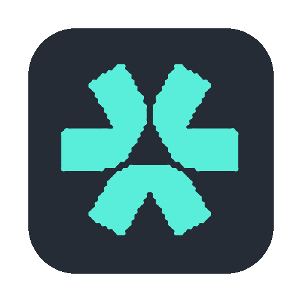

#  AIPulse

> **Stay Connected to the Pulse of AI.**

A modern intelligence and feed platform designed to keep you updated on the latest AI breakthroughs, discussions, research, and insights across social networks and publishing platforms. Available on Desktop (Linux, macOS, Windows), Android, and iOS.

[](https://apps.apple.com/us/app/nora-sns-browser/id6758549275)
[](https://play.google.com/store/apps/details?id=jp.nonbili.nora)
[](https://f-droid.org/packages/jp.nonbili.nora/)
[](https://github.com/nonbili/Nora/releases/latest)

AIPulse Desktop features a deck view to easily browse multiple timelines side-by-side. Linux, macOS, and Windows versions are available.

## Features

- **Unified Intelligence Feed:** Aggregate posts, articles, and newsletters from social media, blogging platforms, and RSS feeds in one organized stream.
- **Platform Feed Filter:** Quickly filter feeds by platform with one tap (All, X, Bluesky, Mastodon, Threads, Reddit, Facebook, Instagram, TikTok, Medium, Substack, WordPress, RSS).
- **Deep Topic & Tag Watching:** Follow topics, tags, and publications directly (e.g. `https://medium.com/tag/artificial-intelligence`, Substack sections, WordPress categories, and RSS/Atom feeds).
- **Deck & Multi-timeline View:** Browse multiple feeds, profiles, and timelines side-by-side on desktop.
- **No Ads & Built-in Blocklist:** Clean reading experience with built-in ad guard and EasyList/EasyPrivacy blocklists.
- **Multiple Accounts:** Separate cookie storage per profile for managing multiple accounts cleanly.
- **Anonymous Mode:** Hide sign-in and open-in-app prompts on Facebook, Instagram, Threads, Tumblr, and X; read without an account.
- **Search Public Posts:** Search public discussions and posts without signing in (via DuckDuckGo).
- **Media Download:** Save images and videos from supported platforms directly.
- **Customization & Dark Mode:** Custom CSS styling, dark/light themes, zoom control, and configurable refresh intervals.

## Supported Platforms

### Social Networks
- **X (Twitter)**
- **Bluesky**
- **Mastodon**
- **Threads**
- **Reddit**
- **LinkedIn**
- **Facebook**
- **Instagram**
- **TikTok**
- **Tumblr**
- **VK**

### Publishing & Blogging Platforms
- **Medium:** User profiles (`@username`), publications (`publication.com`), and topics/tags (`medium.com/tag/artificial-intelligence`).
- **Substack:** Newsletters, author profiles, and publication sections (`publication.substack.com`, custom domains).
- **WordPress:** Self-hosted and WordPress.com blogs, tags, and category feeds.
- **RSS & Atom:** Direct support for standard RSS 2.0 and Atom 1.0 feeds (AI research blogs, tech newsletters, publication feeds).

## Getting Started

### Desktop Development

```sh
# Run desktop in development mode
cd desktop
bun run dev
```

### Production Build

```sh
# Bundle web assets
bun run bundle

# Build desktop application
cd desktop
bun run build

# Start preview
bun run start
```

### Running Tests

Run the full test suite with Bun:

```sh
bun test
```

## Screenshots

  

  

## Contributing

See [CONTRIBUTING.md](CONTRIBUTING.md) for development and testing instructions.

## Translation

Translation is supported by [Weblate](https://hosted.weblate.org/projects/nora).
