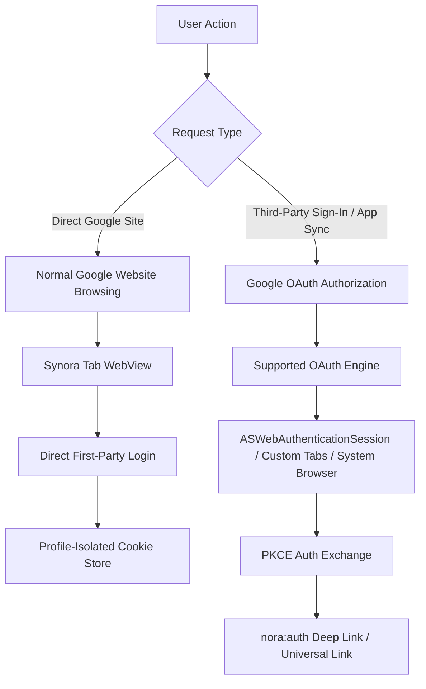

# Google Authentication Architecture & Implementation Plan

## 1. Executive Summary

This document outlines the architectural strategy and phased implementation plan for supported, production-grade Google Authentication across Synora (Desktop, Android, and iOS).

### 1.1 Current State & Workaround Limitations
Historically, Synora attempted to mitigate Google's embedded browser blocks using:
1. **User-Agent Spoofing:** Replacing Chromium UA strings with Firefox desktop strings (`FIREFOX_UA`) in Electron sessions for `accounts.google.*`.
2. **Client Hints Stripping:** Deleting `Sec-CH-UA`, `Sec-CH-UA-Mobile`, `Sec-CH-UA-Platform`, and `X-Client-Data` headers.
3. **DOM Fingerprint Masking:** Injecting client-side JavaScript (`OAUTH_SHIM_SCRIPT`) to define dummy `window.chrome` objects and delete `navigator.webdriver`.

These workarounds are fragile, fail Google BotGuard integrity checks, break RFC 8252 (OAuth 2.0 for Native Apps) best practices, and trigger `403 disallowed_useragent` errors.

### 1.2 Guiding Principles
- **No Workaround Extensions:** Synora will not extend User-Agent spoofing, header stripping, or fingerprint masking.
- **RFC 8252 Compliance:** Authentication flows must adhere to modern OAuth 2.0 native client standards.
- **Strict Boundary Respect:** External-browser cookies cannot and must not be extracted or injected into Synora's internal WebViews.

---

## 2. Distinction: Normal Google Website Browsing vs. Google OAuth Authorization

A critical distinction in Synora's architecture is separating **ordinary Google web usage** from **Google OAuth 2.0 authorization**.



### 2.1 Normal Google Website Browsing
- **Target Services:** Google Search (`google.com`), YouTube (`youtube.com`), Gemini (`gemini.google.com`), Gmail, Google Maps.
- **Execution Context:** Standard Synora tab WebViews (`NouWebView` on Android, `WKWebView` on iOS, `<webview>` on Desktop).
- **Authentication Mechanism:** Direct first-party session establishment on Google domains. When navigating directly to `accounts.google.com` to sign into YouTube or Google services, standard WebViews operate without triggering OAuth 2.0 embedded restrictions.
- **Session & Profile Isolation:** Each Synora profile retains its own dedicated cookie/storage partition:
  - **Android:** Android 14+ `androidx.webkit.ProfileStore` per named profile (`default`, work, personal, etc.).
  - **iOS:** `WKWebsiteDataStore(forIdentifier:)` on iOS 17+.
  - **Desktop:** Electron partitioned sessions (`persist:${profile}`).

### 2.2 Google OAuth 2.0 Authorization
- **Target Endpoints:** `https://accounts.google.com/o/oauth2/v2/auth`, Google Identity Services, One Tap API.
- **Use Cases:**
  1. **Federated Third-Party Logins:** Web applications rendered in Synora tabs (e.g., LinkedIn, Reddit, Canva) offering "Sign in with Google".
  2. **Synora Application Authentication:** Tab synchronization and user account management powered by Supabase.
- **Enforcement Mechanism:** Google BotGuard detects WebKit/Chromium embedded WebView environments (checking WebGL contexts, IPC bindings like `window.NoraI`, and lack of OS-level passkey/keystore bindings) and explicitly blocks them with `403 disallowed_useragent`.

---

## 3. Cookie Sharing Reality & Platform Sandbox Boundaries

A common misconception is that logging into Google via the system browser (Chrome on Android or Safari on iOS) can automatically authenticate Synora's WebViews by sharing cookies.

### 3.1 Security & Sandbox Boundaries
1. **Android:**
   - Chrome's cookie database resides in `/data/data/com.android.chrome/app_chrome/Default/Cookies`, isolated by Linux UID permissions.
   - Android system `WebView` runs inside Synora's app sandbox (`/data/data/jp.nonbili.nora/`).
   - Android Custom Tabs run inside the Chrome application process and share Chrome's cookie jar, but **do not expose cookies to the host app's WebViews**.
2. **iOS:**
   - Safari cookies reside in system-protected containers inaccessible to third-party applications.
   - `ASWebAuthenticationSession` shares cookies with Safari (or provides an ephemeral session), but its cookie store is strictly isolated from the app's `WKWebView` data stores (`WKWebsiteDataStore`).
3. **Desktop (Electron):**
   - The user's external Chrome or Firefox profile is stored outside Electron's application directory and encrypted with OS keychain credentials (DPAPI on Windows, Secret Service on Linux, Keychain on macOS).
   - Electron sessions are partitioned (`persist:profileName`) and cannot read system browser cookies.

### 3.2 Architectural Implication
**Synora must not attempt cookie extraction or injection.** Authentication must be token-based or executed through official APIs.

---

## 4. Supported Architecture for Google Authentication

### 4.1 Architecture for Synora App Sync Authentication
For synchronizing tabs and user preferences via Supabase:
- **Mobile (Android & iOS):**
  - Utilizes `expo-web-browser` (`WebBrowser.openAuthSessionAsync`).
  - On iOS: Launches `ASWebAuthenticationSession`.
  - On Android: Launches Android Custom Tabs.
  - Flow:
    1. Synora generates PKCE code verifier and code challenge.
    2. Opens Google OAuth authorization URL via Supabase.
    3. User authorizes in the secure system browser environment (where Google allows sign-in and supports passkeys/hardware security keys).
    4. System browser redirects to `nora://auth?code=...`.
    5. Synora's deep link handler (`components/link/NouLink.native.tsx` / `states/auth.ts`) catches the redirect, exchanges the authorization code with PKCE, and securely stores the Supabase session token in MMKV/Keychain.
- **Desktop (Electron):**
  - Starts a temporary local loopback server (`http://127.0.0.1:[port]/callback`).
  - Launches system default browser via Electron `shell.openExternal`.
  - Captures callback with PKCE code exchange.

### 4.2 Architecture for In-WebView Federated "Sign in with Google" (e.g. LinkedIn, Reddit)
When a third-party website inside a Synora tab triggers "Sign in with Google":

#### Option A: WebView Credential Management API Bridge (Recommended)
Modern sites use Google Identity Services (`google.accounts.id.initialize` / One Tap) which relies on the standard W3C Credential Management API (`navigator.credentials.get()`).
- Synora injects a lightweight polyfill bridging `navigator.credentials.get({ identity: ... })` to the native platform:
  - **Android:** Android Credential Manager API (`androidx.credentials.CredentialManager`) with `GetGoogleIdOption`.
  - **iOS:** Native Google Sign-In or `ASWebAuthenticationSession`.
- The native layer presents Google's secure system sheet, obtains the Google ID token, and resolves the JavaScript Promise back to the website.
- **Advantage:** No popup windows needed; completely supported by Google; zero spoofing.

#### Option B: Secure OAuth Custom Tab Bridge with Opener Proxy
For sites using traditional `window.open` OAuth redirects:
- When a web page requests `accounts.google.com/o/oauth2/v2/auth`:
  1. Capture the request in `onCreateWindow` (Android) or `createWebViewWith` (iOS).
  2. Open an `ASWebAuthenticationSession` / Custom Tab with a Synora redirect proxy URI.
  3. When Google redirects to the callback URI, return the authorization code to the originating tab via JavaScript `window.postMessage` to simulate standard popup completion.

---

## 5. Phased Implementation Roadmap

### Phase 1 (Completed in this Release)
- [x] Fix Facebook OAuth popups: Update `isGoogleOAuthPopupUrl()` on Android and iOS to recognize Facebook/Meta and Instagram OAuth endpoints.
- [x] Preserve popup opener/callback relationships without destroying popups or converting them to orphan tabs.
- [x] Fix Facebook navigation: Protect login, OAuth, checkpoint, 2FA, and security routes from desktop-to-mobile rewrites in `shouldRedirectFacebookToMobile()`.
- [x] Implement privacy-safe authentication diagnostics logging with query parameter sanitization (redacting tokens, secrets, codes, and credentials).
- [x] Ensure `shouldOpenInSystemBrowser` excludes Google domains on Android, preventing premature ejection to external browsers.

### Phase 2: Google App Auth Stabilization (Completed in this Release)
- [x] Migrate Desktop Electron Google login to system browser loopback PKCE flow, fully deprecating `FIREFOX_UA` header spoofing.
- [x] Strict loopback security: bind strictly to 127.0.0.1, validate Host header, path, remote address, and enforce single-use callback lock.
- [x] Supabase owns PKCE verifier generation and storage (`signInWithOAuth` + `exchangeCodeForSession`); no secrets over IPC.
- [x] Standardize mobile deep link handling across Expo Router for `nora://auth` PKCE callbacks.
- [x] Preserve existing email OTP / magic-link handling (`t=`) alongside OAuth PKCE callbacks (`code=`).
- [x] Safe cancellation and timeout (120s) handling with user-facing styled HTML pages.
- [x] Comprehensive unit test suite covering loopback security and auth callback routing.

### Phase 3: In-WebView Federated Google Sign-In
- [ ] Implement native Expo module bridge for Android Credential Manager (`androidx.credentials`).
- [ ] Implement W3C `navigator.credentials.get()` bridge in `content/main.ts` for Google Identity Services.
- [ ] Deprecate `OAUTH_SHIM_SCRIPT` once native credential bridge is active.

---

## 6. Verification & Test Matrix

| Platform | Verification Requirement | Expected Outcome | Automated Test / Verification Status |
| :--- | :--- | :--- | :--- |
| **Android** | In-tab browsing on `google.com`, `youtube.com` | Loads directly in `NouWebView` with native Chrome UA; direct login works | Unit tests pass; needs physical Android device verification |
| **Android** | Open External Link in System Browser setting | Google domains are not kicked out to system browser | Unit tests pass; needs physical Android device verification |
| **Android** | App Sync Login via Google OAuth | `WebBrowser.openAuthSessionAsync` launches Google login and redirects to `nora://auth` | Deep link & PKCE parsing tests pass; needs physical device verification |
| **iOS** | In-tab browsing on `google.com`, `youtube.com` | Loads directly in `WKWebView` with native Safari UA; direct login works | Unit tests pass; needs physical iOS device verification |
| **iOS** | App Sync Login via Google OAuth | `ASWebAuthenticationSession` launches Google login and redirects to `nora://auth` | Deep link & PKCE parsing tests pass; needs physical device verification |
| **Desktop (macOS)** | App Sync Login via Google OAuth | Default system browser opens Google OAuth, redirects to `127.0.0.1:[port]/callback`, PKCE exchanges session | Loopback security & IPC tests pass; build verified |
| **Desktop (Windows)** | App Sync Login via Google OAuth | Default system browser opens Google OAuth, redirects to `127.0.0.1:[port]/callback`, PKCE exchanges session | Loopback security & IPC tests pass; build verified |
| **Desktop (Linux)** | App Sync Login via Google OAuth | Default system browser opens Google OAuth, redirects to `127.0.0.1:[port]/callback`, PKCE exchanges session | Loopback security & IPC tests pass; electron-vite build passes |

---

## 7. Phase 2 Architecture & Security Specifications

### 7.1 PKCE Ownership & Session Establishment
1. **Client Persistence:** The Supabase JavaScript client instance in the renderer generates the PKCE `code_verifier` and stores it in its own partitioned local storage under `${storageKey}-code-verifier`.
2. **Authorization Request:** The renderer invokes:
   ```typescript
   const { data, error } = await supabaseAuth.signInWithOAuth({
     provider: 'google',
     options: { redirectTo, skipBrowserRedirect: true }
   })
   ```
   Supabase attaches `code_challenge` (SHA-256) and `code_challenge_method=s256` to the returned URL.
3. **External Browser Hand-off:** Main process receives `data.url` and launches the system browser with `shell.openExternal`. No credentials or verifiers cross the IPC bridge.
4. **Code Exchange:** When the callback arrives at the loopback server, Electron Main forwards **only** the authorization `code` to the renderer. The renderer invokes:
   ```typescript
   await supabaseAuth.exchangeCodeForSession(code)
   ```
   The original Supabase client reads its stored `code_verifier`, completes the token exchange directly with Supabase GoTrue (`POST /token?grant_type=pkce`), and establishes the session. Tokens and refresh tokens never touch Main IPC.

### 7.2 Loopback Server Security Hardening
- **Loopback-Only Binding:** The temporary HTTP server binds exclusively to `127.0.0.1` (`server.listen(port, '127.0.0.1')`).
- **Remote Address Enforcement:** Every incoming connection verifies `req.socket.remoteAddress === '127.0.0.1' || req.socket.remoteAddress === '::ffff:127.0.0.1'`. Any other address receives `403 Forbidden` and socket destruction.
- **Host Header Validation:** The server strictly validates `req.headers.host` against `127.0.0.1:${port}` and `localhost:${port}`, mitigating DNS rebinding attacks.
- **Path Whitelisting:** Only `/callback` requests are processed; all others return `404 Not Found`.
- **Single-Use Callback Guard:** Once a successful authorization code is accepted, subsequent requests return `409 Conflict`.
- **Automatic Lifecycle Cleanup:** The server shuts down immediately upon callback completion, cancellation, or a 120-second timeout.
- **Log Hygiene:** Authorization codes, access tokens, and sensitive query parameters are never logged.

### 7.3 Supabase Redirect Allowlist Configuration
In the Supabase Project Dashboard (`Authentication` → `URL Configuration` → `Redirect URLs`), the following patterns must be allowlisted:
- `http://127.0.0.1:*/callback` (Desktop loopback dynamic ports)
- `http://localhost:*/callback` (Desktop loopback localhost fallback)
- `nora://auth` (Native Android and iOS app authentication)

---

## 8. Manual Device Verification Checklist

> [!IMPORTANT]
> Automated tests verify loopback protocol compliance, query parsing, and build compilation. The following physical and platform checks must be executed before claiming production readiness:

### Android Physical Device Checklist
- [ ] Install latest release APK on Android 14+ physical device.
- [ ] Navigate to Settings › Sync and tap "Sign in with Google".
- [ ] Verify Chrome Custom Tab opens with Google sign-in UI (no "disallowed_useragent" or embedded browser block).
- [ ] Authenticate with a Google account (including passkey/2FA if configured).
- [ ] Verify Chrome Custom Tab redirects to `nora://auth` and automatically closes.
- [ ] Verify Synora transitions to the authenticated Sync view showing the account email and plan.
- [ ] Tap "Sign in with Email", receive magic link, and verify `nora://auth?t=...` verification succeeds.
- [ ] Verify direct browsing to `google.com` and `youtube.com` works in normal tabs with profile isolation intact.

### iOS Physical Device Checklist
- [ ] Build and install on iOS 17+ device via Xcode / TestFlight.
- [ ] Navigate to Settings › Sync and tap "Sign in with Google".
- [ ] Verify `ASWebAuthenticationSession` system modal appears asking permission to sign in with "synora".
- [ ] Authenticate with Google account.
- [ ] Verify sheet automatically dismisses upon `nora://auth` redirect.
- [ ] Verify Synora transitions to the authenticated Sync view.
- [ ] Verify tab bookmarks and settings sync correctly across devices.

### Desktop (macOS / Windows / Linux) Checklist
- [ ] Launch Synora desktop application.
- [ ] Open Settings › Sync and click "Sign in with Google".
- [ ] Verify the system's default browser (e.g. Chrome, Firefox, Safari, Edge) opens with Google Sign-In.
- [ ] Authenticate in the browser.
- [ ] Verify the browser displays the dark-themed "Authentication Successful" confirmation card.
- [ ] Return to Synora and verify session establishment without manual code pasting.
- [ ] Test cancellation: click "Sign in with Google", close the browser tab without logging in, and verify Synora handles timeout/cancellation cleanly.

