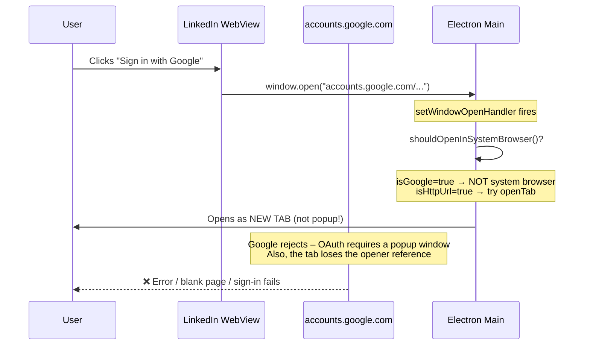

# Google OAuth Login Fix — Nora Desktop

## Root Cause Analysis

When the app is installed as a **desktop (Electron)** app, signing in to sites like LinkedIn using Google OAuth fails. Here is why:



### Bug 1 — Google OAuth popup is opened as a flat tab (Electron webview)

**File:** [`desktop/src/main/index.ts` L223–L231](file:///home/diya/Nora/desktop/src/main/index.ts#L223-L231)

```typescript
wc.setWindowOpenHandler((details) => {
  if (isWatchPage(wc.id)) return { action: 'deny' }
  const url = normalizeExternalTargetUrl(details.url)
  if (shouldOpenInSystemBrowser(url, details.referrer.url || wc.getURL())) {
    shell.openExternal(url)
  } else if (isHttpUrl(url)) {
    uiClient.openTab(url, wc.id)   // ← Google popups land here as flat tabs
  }
  return { action: 'deny' }   // ← always deny = no popup window created
})
```

The `isGoogle` guard in `shouldOpenInSystemBrowser` was added to prevent Google URLs from being forwarded to the system browser (correct!), but the fallback `uiClient.openTab()` opens them as a **regular tab**, not an Electron popup window. Google's OAuth **requires** a real popup with an `opener` reference — a flat tab breaks the OAuth flow.

**Fix:** When the target URL is an OAuth-related Google domain AND the popup was explicitly requested (i.e., `details.disposition === 'foreground-tab'` or the URL is on `accounts.google.com`), create a temporary child `BrowserWindow` that acts as a popup. When it navigates to `nora:auth`, close it and dispatch the callback.

---

### Bug 2 — `nora:auth` deeplink callback is NOT wired up for the desktop renderer's `NouLink`

**File:** [`components/link/NouLink.tsx`](file:///home/diya/Nora/components/link/NouLink.tsx) (web/desktop version)

```typescript
export const NouLink = (props: any) => {
  return <a target="_blank" {...props} />   // ← just a plain <a>, no auth handling
}
```

vs. the native version [`components/link/NouLink.native.tsx`](file:///home/diya/Nora/components/link/NouLink.native.tsx):

```typescript
const result = await openAuthSessionAsync(href, 'nora:auth')
if (result.type === 'success' && result.url) {
  await onReceiveAuthUrl(result.url)
}
```

On **desktop**, clicking "Login Nora" in `SettingsModalTabSync` opens `https://nora.inks.page/auth/app` in the system browser. When login completes, the site redirects to `nora:auth?t=TOKEN`. This URL is handled by the OS protocol handler (`nora:` scheme registered in `electron-builder.yml`), which launches a second Nora instance. That second instance dispatches through `second-instance` → `uiClient.handleDeeplink()` → `openSharedUrl()` → `onReceiveAuthUrl()`. **This chain works** — but only when Nora is already installed with the protocol handler registered. During development, or on first launch before single-instance lock is set, the callback can silently fail.

**Bug 2b:** The desktop renderer's `NouLink.tsx` has no special handling for auth URLs — it always opens in the system browser. This is by design for desktop (use the OS handler), so the protocol chain is what matters. However, there is no **fallback** if the protocol callback silently fails (e.g., the app is not registered as the `nora:` handler yet).

---

### Bug 3 — Google OAuth popup inside LinkedIn webview is blocked

When the LinkedIn webview (`<webview>` tag) triggers `window.open('https://accounts.google.com/...')`:

- `setWindowOpenHandler` intercepts it
- `shouldOpenInSystemBrowser` returns `false` (because `isGoogle = true`)  
- `uiClient.openTab()` is called → opens as a NEW TAB in Nora's UI  
- Google receives the request **without an opener reference** and **without a popup context** → OAuth fails

The fix is to create a **child BrowserWindow popup** for Google OAuth URLs.

---

## Fixes

### Fix 1 — Create a Google OAuth popup window (Electron main)

**File to modify:** [`desktop/src/main/lib/google-auth-popup.ts`](file:///home/diya/Nora/desktop/src/main/lib/google-auth-popup.ts) *(new file)*

```typescript
import { BrowserWindow, session } from 'electron'
import { mainWindow } from './main-window'
import { uiClient } from 'main/ipc/ui'

const GOOGLE_AUTH_HOSTS = new Set([
  'accounts.google.com',
  'accounts.google.co.in',
])

export function isGoogleAuthUrl(url: string): boolean {
  try {
    const { host } = new URL(url)
    return GOOGLE_AUTH_HOSTS.has(host.toLowerCase())
  } catch {
    return false
  }
}

/**
 * Open a temporary popup BrowserWindow for Google OAuth.
 * When the popup navigates to a nora: callback URL, close it
 * and dispatch the deeplink to the renderer.
 */
export function openGoogleAuthPopup(url: string, parentWebContentsId: number): void {
  const parent = mainWindow ?? undefined

  const popup = new BrowserWindow({
    width: 500,
    height: 650,
    parent,
    modal: false,
    autoHideMenuBar: true,
    webPreferences: {
      sandbox: true,
      contextIsolation: true,
      // Use the same session as the webview that triggered the login,
      // so cookies set during OAuth are visible to LinkedIn.
      session: session.fromPartition(`persist:default`),
    },
  })

  popup.webContents.on('will-navigate', (_event, navUrl) => {
    if (navUrl.startsWith('nora:')) {
      popup.close()
      uiClient.handleDeeplink(navUrl)
    }
  })

  popup.webContents.on('will-redirect', (_event, navUrl) => {
    if (navUrl.startsWith('nora:')) {
      popup.close()
      uiClient.handleDeeplink(navUrl)
    }
  })

  popup.loadURL(url)
}
```

**File to modify:** [`desktop/src/main/index.ts`](file:///home/diya/Nora/desktop/src/main/index.ts) — update `setWindowOpenHandler` for webviews

```typescript
// Add import at top:
import { isGoogleAuthUrl, openGoogleAuthPopup } from './lib/google-auth-popup'

// In did-attach-webview handler, replace wc.setWindowOpenHandler:
wc.setWindowOpenHandler((details) => {
  if (isWatchPage(wc.id)) return { action: 'deny' }
  const url = normalizeExternalTargetUrl(details.url)
  
  // Google OAuth: open as a child popup window, not as a flat tab
  if (isGoogleAuthUrl(url)) {
    openGoogleAuthPopup(url, wc.id)
    return { action: 'deny' }
  }
  
  if (shouldOpenInSystemBrowser(url, details.referrer.url || wc.getURL())) {
    shell.openExternal(url)
  } else if (isHttpUrl(url)) {
    uiClient.openTab(url, wc.id)
  }
  return { action: 'deny' }
})
```

---

### Fix 2 — Use the correct session partition per webview profile for the popup

The popup should use the **same session as the webview that triggered login** so LinkedIn sees the resulting auth cookie. Update `openGoogleAuthPopup` to accept a `partition` parameter:

```typescript
export function openGoogleAuthPopup(url: string, partition: string): void {
  const popup = new BrowserWindow({
    webPreferences: {
      session: session.fromPartition(partition),
      ...
    },
  })
  ...
}
```

And pass the partition from `index.ts`:

```typescript
wc.setWindowOpenHandler((details) => {
  ...
  if (isGoogleAuthUrl(url)) {
    // wc.session.partition format: "persist:profileId"
    openGoogleAuthPopup(url, wc.session.storagePath ?? 'persist:default')
    return { action: 'deny' }
  }
  ...
})
```

---

### Fix 3 — Ensure `will-navigate` also catches Google auth redirects (Linux)

On Linux, some OAuth flows navigate within the same webview instead of opening a popup. Add a `will-navigate` handler for the Google OAuth callback:

```typescript
wc.on('will-navigate', (event, rawUrl) => {
  if (isWatchPage(wc.id)) {
    if (!isHttpUrl(rawUrl)) event.preventDefault()
    return
  }
  const url = normalizeExternalTargetUrl(rawUrl)
  if (!shouldOpenInSystemBrowser(url, wc.getURL())) {
    return
  }
  event.preventDefault()
  shell.openExternal(url)
})
```

This is already in place. For Google auth, `shouldOpenInSystemBrowser` returns `false` (correctly), so the in-webview navigation is allowed. ✅

---

### Fix 4 — Desktop `NouLink` for auth URLs (open in-app browser, not system browser)

The "Login Nora" button in `SettingsModalTabSync` renders with `NouLink`, which on the desktop (web renderer) is just an `<a target="_blank">`. When the user clicks it, it opens `nora.inks.page/auth/app` in the system browser. That works via the OS deeplink — but it's a poor UX (requires jumping to a system browser and back).

**Better UX fix:** Handle this in `desktop/src/renderer/App.tsx` or a new renderer-side helper using `shell.openExternal` via IPC — which is what already happens. The existing flow is acceptable as long as the `nora:` protocol is registered.

**What needs fixing:** Add a **fallback polling mechanism** in the renderer that listens for a `nora:auth` callback if the protocol handler was not invoked (e.g., the system opened the URL in a browser but the OS didn't invoke the app's second instance). This is an edge case but can happen on **Linux with Flatpak/Snap** if the URI handler isn't registered.

---

## Platform-Specific Notes

| Platform | Google OAuth Popup | `nora:auth` Callback | Status |
|----------|-------------------|---------------------|--------|
| **macOS** | ❌ Opens as tab, fails | ✅ `open-url` fires | Needs Fix 1 |
| **Windows** | ❌ Opens as tab, fails | ✅ `second-instance` with arg | Needs Fix 1 |
| **Linux (AppImage)** | ❌ Opens as tab, fails | ✅ `second-instance` with arg (if xdg registered) | Needs Fix 1 + xdg check |
| **Linux (Snap)** | ❌ Opens as tab, fails | ⚠️ May not fire if URL handler not registered | Needs Fix 1 + Fix 4 |
| **Linux (Flatpak)** | ❌ Opens as tab, fails | ⚠️ Needs flatpak portal handler | Needs Fix 1 + Fix 4 |
| **iOS** | N/A (uses `openAuthSessionAsync`) | ✅ `nora:auth` redirect caught | ✅ Already works |
| **Android** | N/A (uses OS Chrome Custom Tab) | ✅ Intent filter handles `nora:` | ✅ Already works |

---

## Files to Change

| File | Change |
|------|--------|
| `desktop/src/main/lib/google-auth-popup.ts` | **New** — popup window factory |
| `desktop/src/main/index.ts` | Import + call `openGoogleAuthPopup` in `setWindowOpenHandler` |
| `desktop/src/main/lib/link-handling.ts` | Export `isGoogleAuthHost()` helper (optional, to avoid duplication) |
| `desktop/src/main/lib/deeplink.ts` | Ensure `open-url` is wired (already done) |

> [!IMPORTANT]
> The core fix is in `index.ts` — the webview's `setWindowOpenHandler` must create a real `BrowserWindow` popup for `accounts.google.com` instead of routing it to `openTab`.

> [!NOTE]  
> iOS and Android are **not affected** — they use `openAuthSessionAsync` and OS Chrome Custom Tabs respectively, which handle Google OAuth popups natively.

> [!WARNING]
> When creating the popup `BrowserWindow`, use `sandbox: true` and `contextIsolation: true` — do NOT inject the Nora preload or content script into the Google auth page.

